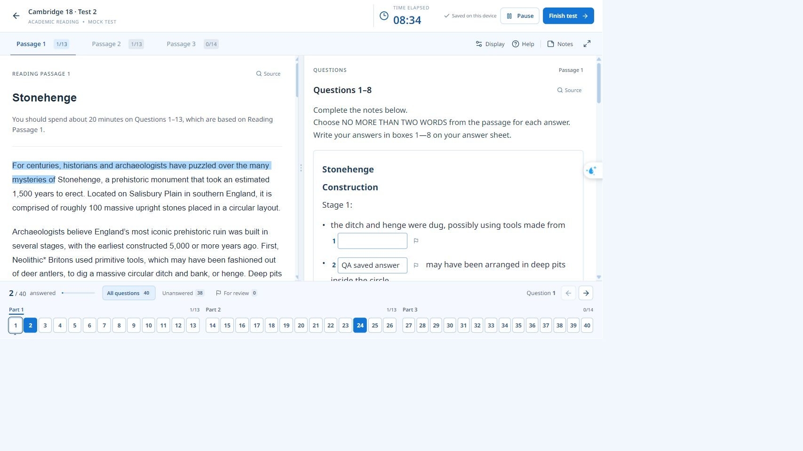
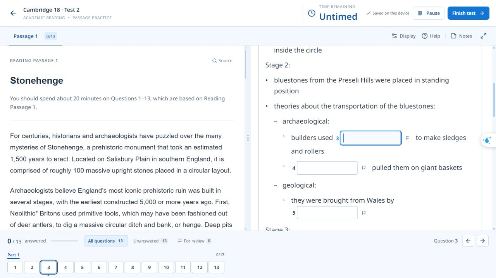
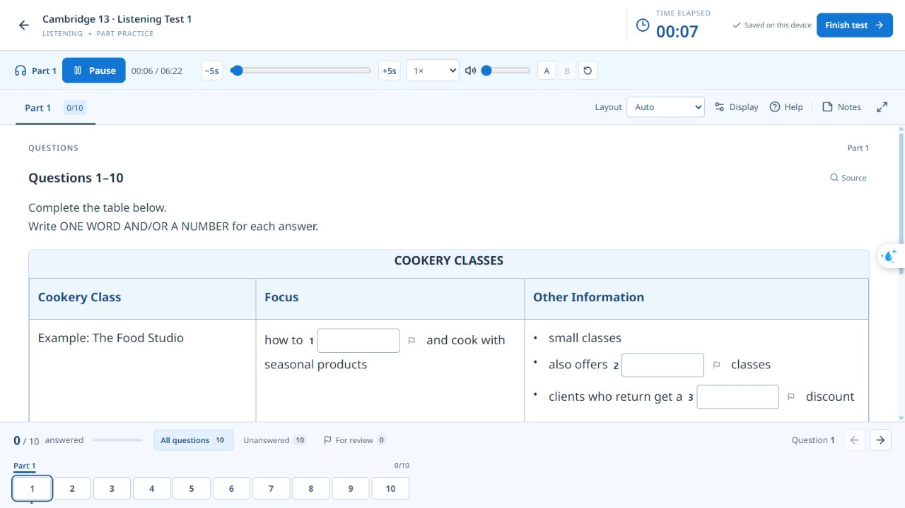
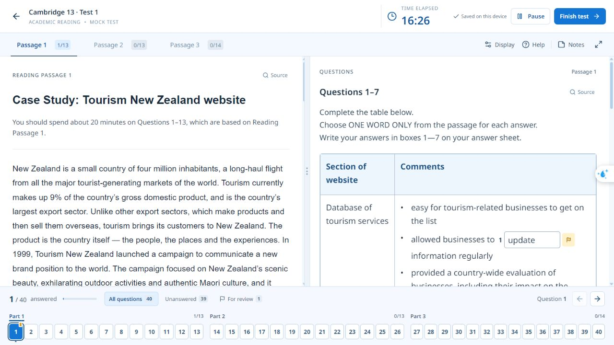
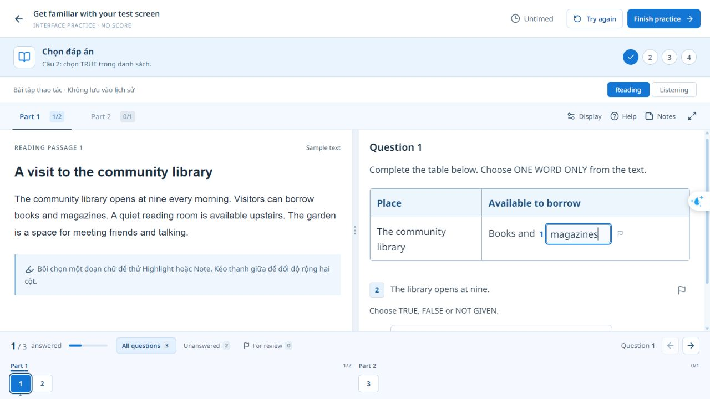

# Bố cục bài thi theo sách — 22/10/2026

Đã cập nhật 18 bảng (7 Reading, 11 Listening) và 146 nhóm điền văn bản (82 Reading, 64 Listening). Chỉ metadata trình bày thay đổi; bài đọc, hướng dẫn, câu hỏi, lựa chọn và khóa chấm giữ nguyên.

## Thay đổi

- Từng bảng có tỷ lệ cột riêng, đúng ô gộp. Reading Cambridge 13 Test 1 dùng 27/73; Cookery Classes dùng 27/32/41. Khung notes về polar bears Cambridge 16 Test 1 không có đường chia hàng bên trong. Hai bảng không kẻ lưới của Cambridge 20 được trình bày nhẹ hơn, với cột tên đủ rộng để đọc nguyên từ.
- Giữ tiêu đề, đề mục, đoạn văn và cấp bullet. Stonehenge phân biệt Stage, archaeological/geological và các mục con. Các xuống dòng chỉ do chiều rộng PDF được hiển thị thành khoảng trắng; ngắt đoạn có ý nghĩa vẫn được giữ.
- Ô có viền, chữ theo Display, rộng cố định theo giới hạn từ 12/16/20ch; hai ô câu 7 Cambridge 15 Test 4 dùng 10ch mỗi ô, vẫn chung một câu và một điểm. Dropdown lưu chữ cái, hiển thị cả nội dung lựa chọn; ngân hàng từ nằm sau phần summary theo nguồn.
- Bảng rộng cuộn ngang trong khung. Tab/Shift+Tab đi qua ô và cờ; footer đưa tới ô của đúng câu. Phần làm quen dùng cùng thành phần nhập và định dạng bảng.

## Đối chiếu và bảo toàn

Đã xem ảnh Source của 18 bảng và 146 nhóm văn bản, gồm các trang nối tiếp. Các tỷ lệ cột và cấp mục được ghi vào metadata. Đây là đợt đối chiếu bố cục, không thay thế báo cáo hiệu đính nội dung hoặc xác minh audio trước đây.

`library/preparation/book-layout-review.json` ghi nguồn, số câu, fingerprint nội dung, hash layout và hash phần chữ hiển thị cho từng nhóm. Công cụ kiểm tra giữ nguyên thứ tự tất cả ô, chữ và dấu câu (trừ bullet, khoảng trắng PDF và số câu bị lặp đầu câu). Mọi mảnh chữ giữ anchor và offset gốc, kể cả khi một chuỗi được tách thành nhiều đề mục hoặc hai cột nhãn/giá trị.

Registry chỉ nâng cấp bài cũ khi cả nội dung gốc và layout cũ khớp phiên bản đã kiểm tra. Không cập nhật snapshot, khóa chấm, chế độ thời gian hoặc kết quả trong SQLite. Đối chiếu 14 lượt làm cá nhân trước/sau cập nhật: payload giữ nguyên; kiểm tra UI dùng cơ sở dữ liệu riêng trong `tmp/`.

## Phạm vi kiểm tra

- 45 kiểm thử Python và 30 kiểm thử frontend; build production và npm audit đạt, không có lỗ hổng được báo.
- Audit 32 đề Reading / 32 đề Listening không báo lỗi; dựng lại 32 đề Reading không đổi byte; 96 file Listening khớp overrides.
- Chrome tại 1280 × 720, cỡ chữ 14/17/24 px: nhập, xóa, cờ, Tab/Shift+Tab, footer, tải lại, thu hẹp cột, khung notes, câu có hai ô, nộp khóa ô và chỉ hiện đáp án sau chấm. Kiểm thử tự động kiểm tra đủ 164 nhóm, ngân hàng từ và anchor của highlight/Note cũ; bộ backend có kiểm tra ZIP cũ/mới và câu nhiều ô.
- Edge không có kết nối điều khiển trong phiên này, nên chưa kiểm tra trực tiếp trên Edge. Không ngắt mạng hệ thống; tài nguyên chạy app đều là local.

## Ảnh giao diện

Bản trước (Stonehenge, ảnh đã có trong repository):

Bản mới, các mục con và ô trả lời tại chỗ:

Bảng Listening mới:

Bảng Reading mới:

Phần làm quen dùng cùng kiểu bảng và ô trả lời:

